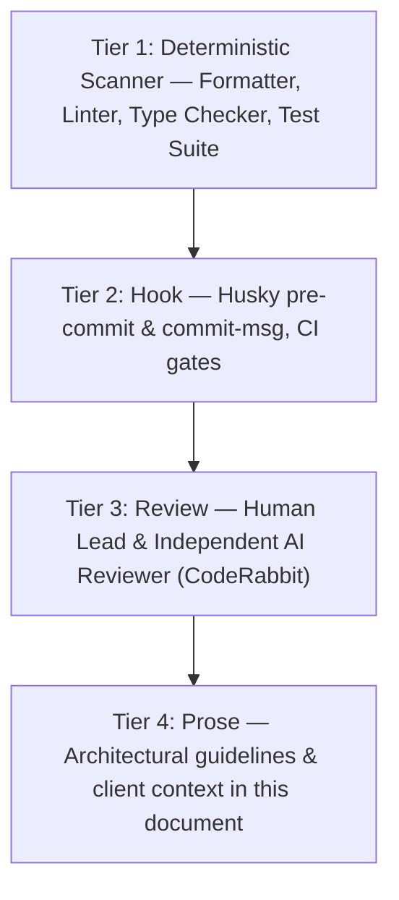

# Coding.md - Development Standards and Guidelines
<!-- Comprehensive coding standards, Next.js architecture, git workflow, Jira lifecycle, and AI review governance -->
<!-- Canonical reference for engineers and AI agents working on Discount Quality Products (DQP) -->
<!-- Last updated: 2026-10-10 -->

---

## 1. The Enforcement Hierarchy

A standard exists at exactly one of four strengths. Every rule in this repository is classified under this hierarchy:



- **Tier 1 — The Scanner:** The deterministic build gate: `tsc --noEmit`, ESLint (flat config), Vitest unit & integration tests, Playwright E2E suites. These run identically for a distracted human and an unattended model at 3 am.
- **Tier 2 — The Hook:** Mandatory event blockers: Husky hooks enforce conventional commit syntax with the required `[DQP]` prefix (`commitlint`), run `lint-staged` with `eslint --fix` on staged files, and CI rejects non-conforming commits or branches.
- **Tier 3 — The Review:** Dual approval gate: independent automated AI review (CodeRabbit) plus human Lead review. Evaluates correctness, business logic, security, and client context.
- **Tier 4 — The Prose:** Architectural documentation, performance constraints, and intent. If an unencoded standard matters, move it down a tier until it executes automatically.

### Verification Commands (Single Gate)

All contributors must ensure local verification passes before pushing:

```bash
npm run typecheck         # TypeScript check (tsc --noEmit)
npm run lint              # ESLint checks across project
npm test                  # Vitest unit and integration test suite
npm run test:coverage     # Coverage verification (minimum 80% on changed lines)
npm run test:e2e          # Playwright headless browser E2E test suite
npm run build             # Full Next.js production build verification
```

---

## 2. Core Coding Standards

### General Principles
1. **Readability over cleverness** — Code is read far more often than it is written. If a clever one-liner needs a comment to explain, write it as clear multi-line code instead.
2. **Explicit over implicit** — Name functions, types, and variables clearly. Avoid cryptic abbreviations. A function named `validateCartTotals` or `fetchWooCommerceCartSession` is far better than `handleCart`.
3. **Single responsibility** — Each function performs one clear responsibility; each file owns one domain concept.
4. **Fail fast and loud** — Validate inputs at the boundary (API routes, server actions, external API integrations). Throw or return descriptive errors; never swallow exceptions silently.
5. **No dead code** — Delete unused functions, commented-out blocks, and obsolete tests. Version control is the history.
6. **Small, reviewable diffs** — A change nobody can hold in their head is a change nobody can reliably review. Keep pull requests focused on a single ticket scope.

### Function & Component Guidelines

```typescript
// Good: Clear name, typed parameters, single purpose, handles empty/edge cases
export function calculateOrderTotal(
  lineItems: OrderLineItem[],
  discountAmount: number,
  shippingCost: number,
): Money {
  if (lineItems.length === 0) {
    return Money.zero();
  }

  const subtotal = lineItems.reduce(
    (sum, item) => sum.add(item.price.multiply(item.quantity)),
    Money.zero(),
  );

  const netSubtotal = subtotal.subtract(Money.fromPounds(discountAmount));
  return netSubtotal.add(Money.fromPounds(shippingCost));
}

// Bad: Vague name, untyped parameters, mixed concerns
function process(data: any, flag: boolean) {
  // 200 lines of mixed UI, validation, and API logic
}
```

### Comments and Documentation
- **Comments explain WHY, not WHAT.** Code itself communicates the implementation; comments record decisions, trade-offs, statutory requirements, and edge cases.
- Reference upstream WooCommerce quirks, UK statutory tax rules, or Bluehost backend limitations directly in comments:

```typescript
// Good: Explains the underlying UK VAT statutory exemption
// Royal Mail 1st Class postage is statutory VAT-exempt.
// For 1st Class, VAT applies only to goods (netSubtotal / 6).
const isFirstClassShipping = shippingTitle.toLowerCase().includes("first class");
const vat = isFirstClassShipping ? (netSubtotal / 6) : (finalTotal / 6);

// Bad: Restates the obvious syntax
// Set isFirstClassShipping to true if title has first class
```

---

## 3. Architecture & Performance Rules (Next.js & WooCommerce)

These domain-specific constraints are non-negotiable across the DQP storefront:

### 1. Product Detail Pages (PDP) Static Generation
- `generateStaticParams` in `src/app/products/[slug]/page.tsx` **MUST NOT** return `[]`.
- It must pre-render the homepage featured and new arrivals product slugs (~12 items).
- All remaining products are generated on-demand and cached via Incremental Static Regeneration (ISR).

### 2. Category & Shop Pages are Dynamic
- `/categories/[slug]/page.tsx` and `/shop/page.tsx` read `searchParams` for filtering, sorting, and pagination. In Next.js App Router, reading `searchParams` makes the route dynamically rendered (`ƒ Dynamic`).
- Do **not** attempt to force static generation on these pages by removing `searchParams`. Instant perceived performance is achieved via streaming `loading.tsx` skeletons and caching category taxonomy lookups.

### 3. Safe Backend Fetching & Timeouts
- Bluehost WordPress backend requests must have an explicit 15-second timeout via `wpFetch`. Do not reduce below 10 seconds.
- **NEVER** call `notFound()` inside a `catch` block on product pages. A network timeout or temporary backend 502 does not mean the product does not exist. Throwing the error triggers `error.tsx` (recoverable with "Try Again"), whereas `notFound()` caches a false 404 response permanently on Vercel's edge cache.

### 4. Targeted Cache Tagging
- Never call `revalidateTag("wc-products")` across the board — doing so invalidates 13,000+ cached products simultaneously, exhausting ISR write quotas.
- Use granular per-product cache tags (`revalidateTag(`product-${slug}`)`).

---

## 4. Canonical Naming Conventions

| Context | Convention | Example |
| :--- | :--- | :--- |
| Files (Components) | PascalCase or kebab-case (consistent per folder) | `ProductCard.tsx` / `order-summary.tsx` |
| Files (Utilities/Libs) | kebab-case or camelCase | `checkout.ts`, `stripe-sync.ts` |
| Files (Tests) | Match target file + `.test.ts` | `vat.test.ts`, `shipping-rates.test.ts` |
| React Components | PascalCase | `MiniCart`, `CheckoutForm` |
| Functions & Methods | camelCase | `validateCartTotals`, `resolveToNumericId` |
| Variables & Properties | camelCase | `finalTotal`, `discountAmount` |
| Constants & Enums | UPPER_SNAKE_CASE | `MAX_PAYMENT_RETRIES`, `WOOCOMMERCE_URL` |
| Types & Interfaces | PascalCase | `CartItem`, `CartValidationResult` |
| Database Fields / Meta | snake_case | `_bypass_low_stock_guard`, `total_discount_tax` |
| API Endpoints | kebab-case | `/api/checkout/shipping-rates`, `/api/checkout/stripe/create-intent` |
| Git Branches | `<type>/<TICKET-KEY>-<description>` | `feat/DQP-3-dynamic-coupons`, `fix/DQP-12-vat-exempt-shipping` |
| Commit Messages | `[PROJECT] <type>(<scope>): <description>` | `[DQP] fix(checkout): address review feedback` |

---

## 5. Error Handling & API Resilience

### Boundary Validation
- Validate all incoming payloads in Next.js Route Handlers (`src/app/api/...`) immediately upon receipt.
- Return explicit HTTP 400 with a descriptive error object if data is missing or malformed:

```typescript
if (!items || items.length === 0 || !address) {
  return NextResponse.json({ error: "Missing items or address in request." }, { status: 400 });
}
```

### Cart & Payment Protection Guard
- Every order creation handler (`create-wc-order`, Stripe intent, PayPal order) **MUST** validate cart integrity using `validateCartTotals`.
- If `!validation.isValid`, order creation must immediately abort with HTTP 400. Orders with invalid coupons, out-of-stock items, or invalid shipping destinations must never be placed or marked paid.

### Async Error Handling
- Always `await` promises. Floating promises are forbidden (`@typescript-eslint/no-floating-promises`).
- When fire-and-forget is strictly intended (e.g., non-blocking analytics/logging), explicitly prefix with `void`:
  ```typescript
  void logAnalyticsEvent(event);
  ```

---

## 6. Git Workflow & Jira Lifecycle

### Branch Naming Specification
Branches are short-lived and tied to a single Jira ticket:
- Pattern: `<type>/<TICKET-KEY>-<kebab-description>`
- Types: `feat`, `fix`, `test`, `refactor`, `perf`, `docs`, `chore`, `ci`, `hotfix`
- Ticket Key: Must be uppercase (e.g. `DQP-3`, `DQP-12`)
- Allowed: `feat/DQP-3-dynamic-coupons`, `fix/DQP-5-cart-total-rounding`
- Forbidden: `feature/coupons` (missing key), `dqp-3-fix` (lowercase key), `yusuf/branch` (personal prefixes).

### Conventional Commits with Project Prefix
Commit messages and PR titles must include the project prefix:
```text
[DQP] feat(checkout): implement dynamic WooCommerce coupon validation (DQP-3)
[DQP] fix(checkout): include total_discount_tax in VAT-inclusive calculations
[DQP] test(checkout): add regression test for shipping-rates API route
```

### Strict Jira Ticket Lifecycle
A ticket follows this deterministic lifecycle and cannot jump states:
1. **Backlog / Selected for Development**
2. **In Progress**: Ticket is assigned to the developer/agent. The branch is created and code is written.
   > **Strict Rule:** The ticket MUST remain **In Progress** while PR checks and automated reviews run. It does NOT move forward while CI is running or if CodeRabbit has requested changes.
3. **Code Review**: Ticket moves here **only after** all CI checks are green (passed) **AND** CodeRabbit has approved the PR.
4. **Awaiting Release**: Ticket moves here once the human Lead approves the PR and merges it into `main`. The feature remains in "Awaiting Release" until manually verified in staging or production.
5. **Done**: Transitioned manually by the human Lead only after confirming live operational correctness.

### Lead Override
- Direct commits to `main` are reserved exclusively for trivial documentation changes (e.g., updating workflow specs) performed by the Lead Engineer.
- All code, test, and infrastructure changes must go through a Pull Request.

---

## 7. Code Review & AI Agent Governance

### Dual Approval Policy
Every pull request requires two distinct approvals before merging:
1. **Automated Review:** CodeRabbit (Independent AI code reviewer).
2. **Human Lead Review:** Yusuf Qureshi (or designated lead engineer).

### Zero Blind Acceptance Rule
- AI-generated code review comments must **never be accepted blindly**.
- Evaluate each finding critically against:
  1. Does it understand the full context of this repository (e.g., UK VAT statutory exemptions, WooCommerce Store API behavior)?
  2. Is it technically accurate for this stack?
  3. Does it break existing functionality or violate client business requirements?
- Push back with technical justification when a suggestion is inaccurate or unnecessary. When valid, implement the fix, add covering tests, and reply directly in the review thread.

### Review Comment Taxonomy
When commenting on PRs, use standard prefixes:
- `blocker:` — Must be resolved prior to approval.
- `concern:` — Potential bug, regression, or architectural issue that needs discussion.
- `suggestion:` — Alternative approach or optimization worth considering.
- `nit:` — Minor styling or non-blocking comment.
- `question:` — Inquiry seeking clarification.
- `praise:` — Highlighting well-crafted code or robust test coverage.

---

## 8. Testing Standards & Test-Driven Development (TDD)

1. **TDD Workflow**: Write failing tests reproducing bug reports or defining new feature acceptance criteria prior to implementing application code.
2. **Changed-Line Test Coverage**: Minimum **80% coverage** required on all new and modified business logic lines.
3. **Regression Tests**: Every bug fix must include an automated regression test reproducing the exact issue so it cannot regress.
4. **Mocking Boundaries**:
   - Unit and integration tests must run offline and deterministically.
   - Never make real HTTP calls to the live Bluehost WordPress server or live Stripe/PayPal APIs during automated tests. Mock network endpoints using Vitest `vi.spyOn(global, 'fetch')` or local `@wordpress/env`.
5. **Test Frameworks**:
   - Unit & Integration: **Vitest** (`npm test`)
   - End-to-End: **Playwright** (`npm run test:e2e`)

---

## 9. Security & Operations Checklist

- [ ] **Input Validation:** All user inputs validated against strict schemas at route handler boundaries.
- [ ] **Cryptographic Verification:** Stripe webhooks cryptographically verified using `stripe.webhooks.constructEvent` with `STRIPE_WEBHOOK_SECRET`.
- [ ] **Bot Protection:** Public form submissions protected with Cloudflare Turnstile token verification (`@marsidev/react-turnstile`).
- [ ] **Sanitization:** HTML output sanitized via `sanitize-html` before rendering.
- [ ] **Secrets Management:** Sensitive keys (`STRIPE_SECRET_KEY`, `WOOCOMMERCE_CONSUMER_SECRET`) strictly confined to server-side environments (`.env.local` / Vercel environment variables); never prefixed with `NEXT_PUBLIC_`.
- [ ] **Idempotency:** Payment webhooks implement idempotent database guards to prevent duplicate order generation or multiple customer receipts.
